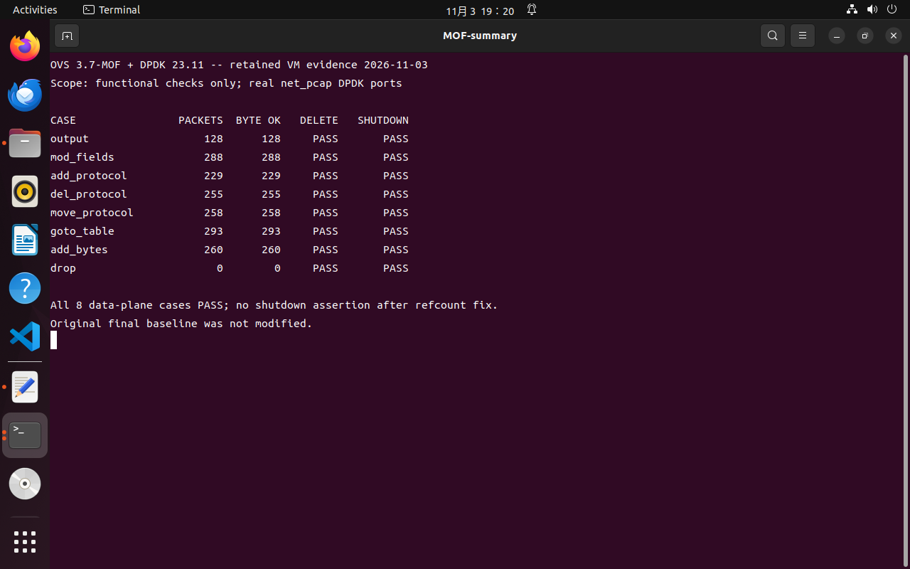
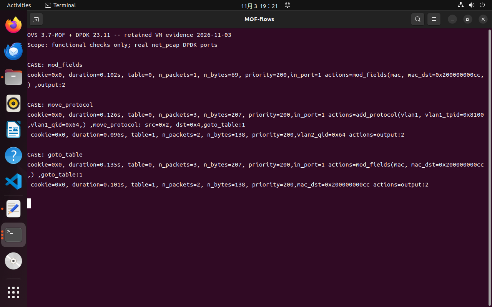
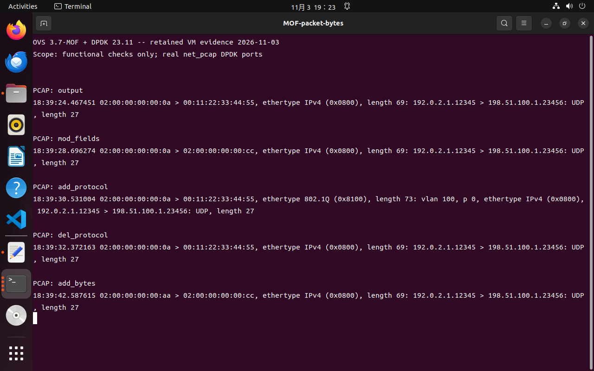
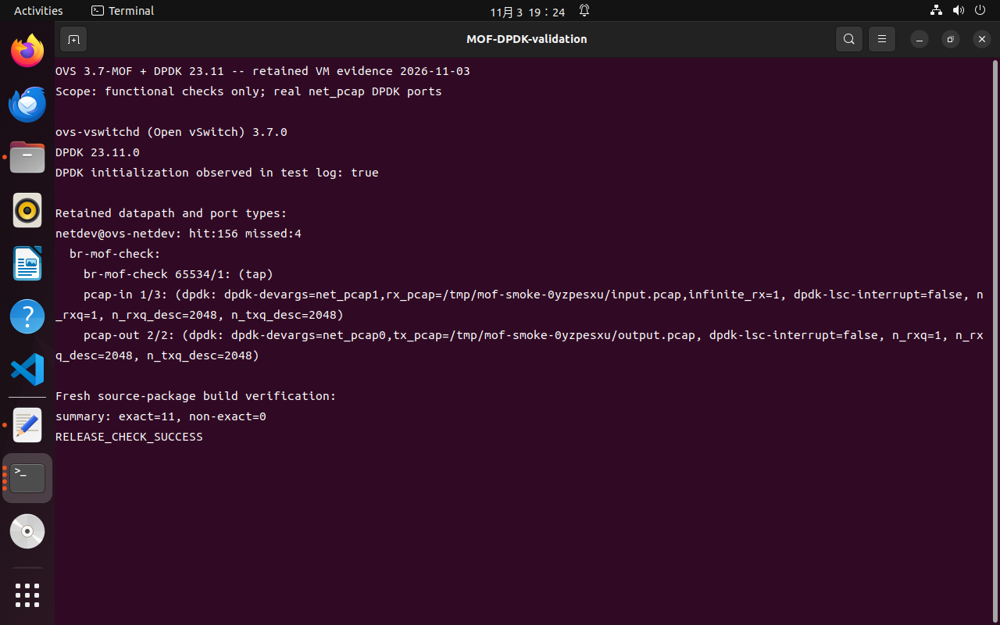

# OVS 3.7 MOF 与 DPDK 23.11 功能复验报告

测试日期：2026-11-03。对象：ovs-3.7-mof-complete。环境：Ubuntu 单虚拟机、2 个逻辑 CPU、约 4 GiB 内存、DPDK 23.11.0、OVS 3.7.0。

## 结论

8 项主要数据面功能通过真实 DPDK PCAP PMD 实测，输出报文逐包满足字节断言。MOF 规则下发、回读、删除通过。本轮定位并修复 MOF 创建规则时遗漏 ofproto 引用导致的清理和退出断言；修复后的退出日志未再出现该断言。

这是一轮功能冒烟验证，未开展性能、长期稳定性、物理网卡或控制器测试。IPv4 与 IPv6 转换、最长前缀匹配、CRC 按已有约定排除，不能据此声称所有功能全部通过。

## 重构和构建

重新运行 Protocol_cfg/configure.sh，输出 Configuration successful。生成器负责的 11 个文件与受保护 final 基线逐字节相同。随后执行 make clean、configure --with-dpdk=shared、make -j2，返回成功；补充修复后再次编译成功。final 保持只读。本轮新增 ofproto/ofproto.c 引用修复不属于这 11 个生成文件，因此完整工程相对 final 多出该修复。

另将待发布 Git 文件生成源码归档，在虚拟机全新目录 /home/ovs/mof-release-check-VeeKGd/ovs-3.7-mof-complete 内运行一键构建。重构、从零编译、二进制校验和 11 文件对照均成功，日志末尾为 RELEASE_CHECK_SUCCESS。打包检查同时修复了空输出目录未创建、Instructions_ori 模板被忽略及 utilities/docker/Makefile 被误排除的问题。

## 方法

使用工程内 ovsdb-server、ovs-vswitchd、ovs-vsctl、ovs-ofctl 和 ovs-appctl。独立数据库位于 /tmp/mof-smoke-*，桥为 netdev，两个 Interface 均为 type=dpdk，设备使用 net_pcap PMD。dpdk_initialized=true，并在 dpif/show 中确认 DPDK 入口、出口；不是仅用普通 Linux 端口验证。

输入为 100 包 IPv4 UDP PCAP，源 MAC 02:00:00:00:00:0a，目的 MAC 00:11:22:33:44:55。循环回放解决流表准备期间有限输入耗尽问题。数据包数随时序变化，不用于推导吞吐率或丢包率。

| 用例 | 输出包数 | 满足字节断言包数 | 规则删除后为空 | 退出断言 | 结果 |
|---|---:|---:|---|---|---|
| output | 128 | 128 | 是 | 无 | 通过 |
| mod_fields | 288 | 288 | 是 | 无 | 通过 |
| add_protocol | 229 | 229 | 是 | 无 | 通过 |
| del_protocol | 255 | 255 | 是 | 无 | 通过 |
| move_protocol | 258 | 258 | 是 | 无 | 通过 |
| goto_table | 293 | 293 | 是 | 无 | 通过 |
| add_bytes | 260 | 260 | 是 | 无 | 通过 |
| drop | 0 | 0 | 是 | 无 | 通过 |

## 每项流表与实包证据

### output

下发规则：

```text
priority=200,in_port=1,actions=output:2
```

回读与命中：

```text
cookie=0x0, duration=0.092s, table=0, n_packets=2, n_bytes=138, priority=200,in_port=1 actions=output:2
```

输出首包原始字节：

```text
00112233445502000000000a0800450000370001000040118e7fc0000201c633640130395ba0002315ba4d4f462d66756e6374696f6e616c2d746573742d7061796c6f6164
```

原始证据：[PCAP](evidence/2026-11-03/output/output.pcap)；[JSON](evidence/2026-11-03/output/results.json)。

### mod_fields

下发规则：

```text
priority=200,in_port=1,actions=mod_fields(mac,mac_dst=0x0200000000cc),output:2
```

回读与命中：

```text
cookie=0x0, duration=0.102s, table=0, n_packets=1, n_bytes=69, priority=200,in_port=1 actions=mod_fields(mac, mac_dst=0x200000000cc,) ,output:2
```

输出首包原始字节：

```text
0200000000cc02000000000a0800450000370001000040118e7fc0000201c633640130395ba0002315ba4d4f462d66756e6374696f6e616c2d746573742d7061796c6f6164
```

原始证据：[PCAP](evidence/2026-11-03/mod_fields/mod_fields.pcap)；[JSON](evidence/2026-11-03/mod_fields/results.json)。

### add_protocol

下发规则：

```text
priority=200,in_port=1,actions=add_protocol(vlan1,vlan1_tpid=0x8100,vlan1_qid=0x0064),output:2
```

回读与命中：

```text
cookie=0x0, duration=0.093s, table=0, n_packets=2, n_bytes=138, priority=200,in_port=1 actions=add_protocol(vlan1, vlan1_tpid=0x8100,vlan1_qid=0x64,) ,output:2
```

输出首包原始字节：

```text
00112233445502000000000a810000640800450000370001000040118e7fc0000201c633640130395ba0002315ba4d4f462d66756e6374696f6e616c2d746573742d7061796c6f6164
```

原始证据：[PCAP](evidence/2026-11-03/add_protocol/add_protocol.pcap)；[JSON](evidence/2026-11-03/add_protocol/results.json)。

### del_protocol

下发规则：

```text
priority=200,in_port=1,actions=add_protocol(vlan1,vlan1_tpid=0x8100,vlan1_qid=0x0064),goto_table:1
table=1,priority=200,in_port=1,actions=del_protocol(vlan1),output:2
```

回读与命中：

```text
cookie=0x0, duration=0.118s, table=0, n_packets=3, n_bytes=207, priority=200,in_port=1 actions=add_protocol(vlan1, vlan1_tpid=0x8100,vlan1_qid=0x64,) ,goto_table:1
 cookie=0x0, duration=0.099s, table=1, n_packets=2, n_bytes=138, priority=200,in_port=1 actions=del_protocol:vlan1 ,output:2
```

输出首包原始字节：

```text
00112233445502000000000a0800450000370001000040118e7fc0000201c633640130395ba0002315ba4d4f462d66756e6374696f6e616c2d746573742d7061796c6f6164
```

原始证据：[PCAP](evidence/2026-11-03/del_protocol/del_protocol.pcap)；[JSON](evidence/2026-11-03/del_protocol/results.json)。

### move_protocol

下发规则：

```text
priority=200,in_port=1,actions=add_protocol(vlan1,vlan1_tpid=0x8100,vlan1_qid=0x0064),move_protocol(src=vlan1,dst=vlan2),goto_table:1
table=1,priority=200,vlan2_qid=0x0064,actions=output:2
```

回读与命中：

```text
cookie=0x0, duration=0.126s, table=0, n_packets=3, n_bytes=207, priority=200,in_port=1 actions=add_protocol(vlan1, vlan1_tpid=0x8100,vlan1_qid=0x64,) ,move_protocol: src=0x2, dst=0x4,goto_table:1
 cookie=0x0, duration=0.096s, table=1, n_packets=2, n_bytes=138, priority=200,vlan2_qid=0x64 actions=output:2
```

输出首包原始字节：

```text
00112233445502000000000a810000640800450000370001000040118e7fc0000201c633640130395ba0002315ba4d4f462d66756e6374696f6e616c2d746573742d7061796c6f6164
```

原始证据：[PCAP](evidence/2026-11-03/move_protocol/move_protocol.pcap)；[JSON](evidence/2026-11-03/move_protocol/results.json)。

### goto_table

下发规则：

```text
priority=200,in_port=1,actions=mod_fields(mac,mac_dst=0x0200000000cc),goto_table:1
table=1,priority=200,mac_dst=0x0200000000cc,actions=output:2
```

回读与命中：

```text
cookie=0x0, duration=0.135s, table=0, n_packets=3, n_bytes=207, priority=200,in_port=1 actions=mod_fields(mac, mac_dst=0x200000000cc,) ,goto_table:1
 cookie=0x0, duration=0.101s, table=1, n_packets=2, n_bytes=138, priority=200,mac_dst=0x200000000cc actions=output:2
```

输出首包原始字节：

```text
0200000000cc02000000000a0800450000370001000040118e7fc0000201c633640130395ba0002315ba4d4f462d66756e6374696f6e616c2d746573742d7061796c6f6164
```

原始证据：[PCAP](evidence/2026-11-03/goto_table/goto_table.pcap)；[JSON](evidence/2026-11-03/goto_table/results.json)。

### add_bytes

下发规则：

```text
priority=200,in_port=1,actions=add_bytes:0x0200000000cc0200000000aa0800,output:2
```

回读与命中：

```text
cookie=0x0, duration=0.098s, table=0, n_packets=2, n_bytes=138, priority=200,in_port=1 actions=add_bytes: 0200000000CC0200000000AA0800,output:2
```

输出首包原始字节：

```text
0200000000cc0200000000aa0800450000370001000040118e7fc0000201c633640130395ba0002315ba4d4f462d66756e6374696f6e616c2d746573742d7061796c6f6164
```

原始证据：[PCAP](evidence/2026-11-03/add_bytes/add_bytes.pcap)；[JSON](evidence/2026-11-03/add_bytes/results.json)。

### drop

下发规则：

```text
priority=200,in_port=1,actions=drop
```

回读与命中：

```text
cookie=0x0, duration=0.094s, table=0, n_packets=2, n_bytes=138, priority=200,in_port=1 actions=drop
```

原始证据：[PCAP](evidence/2026-11-03/drop/drop.pcap)；[JSON](evidence/2026-11-03/drop/results.json)。

## 本轮发现及修复

首次连续切换端口测试在 oftable_destroy() 触发 classifier_is_empty 断言；独立测试退出时触发 ovs_refcount_unref() 的 old_refcount > 0 断言。对照 OVS 3.7 原生 ofproto_rule_create() 后发现 MOF 创建分支没有取得 ofproto 引用，而共用析构函数会释放引用。

修复为在 ofproto_rule_create_mof() 分配规则前调用 ofproto_try_ref()，失败时返回错误，并在规则分配失败时调用 ofproto_unref()。补丁保存在源码 ofproto/ofproto.c 及 patches/ovs37-mof-rule-refcount.patch，受保护 final 未修改。修复后的 8 项独立复验均无退出断言；同一实例连续创建、删除端口和流表的回归为 8/8，通过后正常退出，见 lifecycle.log。增加独立 DPDK file-prefix 后又执行一次同样回归，仍为 8/8，见 lifecycle-prefix.log。

修复前日志保存在 smoke.log、isolated-smoke-v2.log、final-smoke.log；修复后日志为 fixed-smoke.log，汇总为 results.json。

## 测试截图

以下为 Ubuntu 虚拟机终端的真实屏幕截图。终端使用 show_evidence.py 展示本轮保留的 JSON、流表回读和 PCAP 证据；截图展示记录复核过程，不表示截图时仍有测试 daemon 持续运行。

### 功能汇总



### 流表命中与多表处理



### 实际输出报文



### DPDK 和构建结果



## 复现

完整步骤、环境依赖、DPDK 安装、大页恢复、构建脚本参数、自定义流表示例及故障排查见 [README](README.md)。

```bash
cd /home/ovs/ovs-3.7-mof-complete
bash build-ovs37-mof.sh --clean --jobs 2
sudo python3 scripts/functional_smoke.py
sudo python3 scripts/functional_smoke.py lifecycle
```
